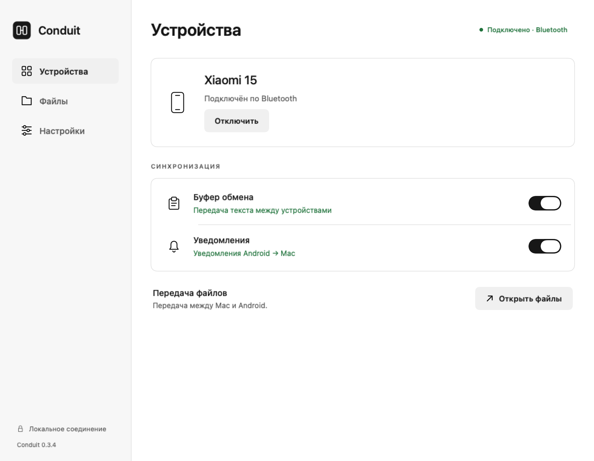

# Conduit 0.3.3

Нативное приложение для Mac и Android-компаньон: буфер обмена, уведомления,
ответы и файлы. Основной режим — Bluetooth; USB / Wi-Fi через ADB тоже сохранён.

**Статус: прототип для испытания.** Обе части собираются, автоматические проверки
проходят. На Xiaomi 15 проверены поиск службы, открытие RFCOMM, аутентификация
живого соединения, вход по коду Conduit и передача буфера Mac → Android.
Ручной и автоматический обратный буфер через Shizuku тоже подтверждены
пользователем. Уведомления, файлы и длительная фоновая работа ещё проверяются.
Подробности в `VALIDATION.md`.

## Исправления 0.3.3

Подписи нижней навигации Android имеют одинаковый шрифт, высоту и выравнивание
на всех вкладках. Выбранная вкладка выделяется цветом и фоном без изменения
метрик текста.

Иконка Mac уменьшена до стандартных отступов: рисунок занимает 824 × 824 пикселя
на холсте 1024 × 1024. Убрана ручная подстановка иконки Dock; приложение использует
зарегистрированный значок из пакета. Для macOS 26 добавлен каталог Icon Composer
`Assets.car`; для старых систем сохранён `AppIcon.icns`. Геометрия знака одинакова
в обоих форматах.

Каталог хранится вместе с манифестом SHA-256 источников и результата. Сборка
проверяет его соответствие исходникам и прекращается при рассинхронизации.

## Исправления 0.3.2

- Android: компактные строки настроек с состояниями Bluetooth, фоновой работы,
  Shizuku, чтения уведомлений и собственных уведомлений Conduit.
- Уже выданные разрешения открывают настройки. Недоступные действия отключены;
  ожидание, разрешённый доступ и ошибки различаются текстом и цветом.
- На Mac отдельно проверяется реальное разрешение уведомлений macOS. После выдачи
  доступа кнопка становится «Настройки»; отключённые баннеры тоже видны в статусе.
- Android использует адаптивную иконку без белой подложки и отдельный монохромный
  значок foreground-уведомления. Mac явно загружает свою иконку и работает с Dock.
- Вместе с уведомлением передаётся значок Android-приложения: PNG 64 × 64,
  показываемый миниатюрой в уведомлении macOS. Аватары из уведомлений не извлекаются.
- После обновления APK восстанавливается привязка слушателя уведомлений; отображаются
  отдельно разрешение доступа и реальное подключение службы.
- Android: системное, светлое и тёмное оформление выбирается внутри Conduit.

На Xiaomi 15 проверены обе темы, верхние и нижние блоки настроек, состояние без
соединения, повторное подключение Bluetooth / Shizuku, иконка в системных настройках
Android и тестовое уведомление на Mac с читаемым вложением-иконкой. Подробности —
в `VALIDATION.md`.

## Интерфейс 0.3.0

Mac и Android используют единое монохромное оформление, светлую и тёмную темы.
Три раздела: «Устройства», «Файлы», «Настройки». На главном экране — соединение,
буфер и уведомления; разрешения и диагностика вынесены в настройки.
Текст описывает состояние и действие. Иконки имеют общий контур; знак приложения
симметричен и одинаков на обеих платформах. Параметры — в [design/README.md](design/README.md).

Обе сборки 0.3.0 проверены компиляцией. SwiftUI-экраны просмотрены в обеих темах
и при минимальной ширине окна. Android 0.3.0 ещё не проверен на физическом телефоне:
результаты испытаний ниже относятся к предыдущим версиям транспорта.



## Что скачать

- [Conduit-0.3.3-Bluetooth-macOS.zip](https://github.com/ogolknev/conduit/releases/download/v0.3.3/Conduit-0.3.3-Bluetooth-macOS.zip): Mac Apple Silicon, macOS 13+.
- [conduit-companion-0.3.3.apk](https://github.com/ogolknev/conduit/releases/download/v0.3.3/conduit-companion-0.3.3.apk): Android 8+, обновление с сохранением прежнего ключа подписи.
- [Релиз 0.3.3](https://github.com/ogolknev/conduit/releases/tag/v0.3.3): обе сборки, исходники и SHA-256.
- Внутри Mac-приложения есть APK и ZIP с APK для отправки на телефон.

## Исправления 0.2.1–0.2.2 на Mac

Ошибки подключения показываются отдельным окном и остаются в карточке соединения.
Видны этап и время ожидания; подключение можно отменить. Исправлены молчаливые
выходы при пустом / устаревшем выборе телефона, добавлены проверки разрешений
и кода, полный поиск SDP и обработка актуальных объектов из callback.
В 0.2.2 запрос SDP с фильтром UUID заменён полным поиском. Проверка на macOS 26.6.2
позднее показала, что этот поиск возвращает сохранённый список, который может устареть.

Кнопка «Скопировать диагностику» копирует этапы и технические коды ошибок.
Журнал — `~/Library/Application Support/Conduit/connection.log`, до 256 КБ.
В журнал не пишутся код сопряжения, токены, текст буфера, сообщения и имена файлов.
После обновления macOS может снова запросить доступ к Bluetooth для локальной сборки.

## Исправления 0.2.4 на Mac

Если Conduit отсутствует в сохранённом списке служб, ручное подключение один раз
переподключает выбранный телефон и повторяет поиск. На проверенном Mac это обновило
каталог с 23 до 24 служб и обнаружило Conduit. То же восстановление допускается
при отказе / таймауте открытия устаревшего канала. В 0.2.4 автоматические попытки сами
телефон не отключали; ограниченное восстановление добавлено в 0.2.5. Перед поиском неподключённого телефона устанавливается
базовое Bluetooth-соединение, перед командами ожидается готовность адаптера.
Дубликаты одного адреса в списке устройств удалены.

На macOS 26.6.2 `getEncryptionMode()` всегда возвращает ноль: локальная проверка
реализации метода подтвердила безусловный возврат константы. Теперь Mac явно
аутентифицирует живое сопряжённое соединение через `requestAuthentication()`.
Android использует защищённый RFCOMM-слушатель, требующий аутентификацию и шифрование.
Код Conduit / токен передаётся после успешной проверки. Проверка нового транспорта
на Xiaomi прошла; затем пользователь подтвердил вход по коду и буфер Mac → Android.
Android-компаньон остаётся 0.2.3.

Поведение кэша также описано в первичных
[измерениях aio-rfcomm](https://dlech.github.io/aio-rfcomm/known-bugs/).
## Исправления 0.2.5 на Mac

После задержки таймера / пробуждения отправляется новый ping и даётся полное
время для ответа. Давний pong сам по себе больше не служит причиной разрыва.
Для активной синхронизации используется ProcessInfo activity, предотвращающая
App Nap; обычный сон Mac остаётся разрешён. Входящие сообщения подтверждают
живую связь, повторные ping не накапливаются до ответа.

Повторы подключения имеют задержки 3, 5, 10, 20, затем 30 секунд. После сбоя
автоматическое подключение может один раз восстановить каталог выбранного
доверенного телефона; между такими разрешениями выдерживается 90 секунд.
Ручная попытка по-прежнему может обновить каталог сразу. Настройка автоподключения
и намерение оставаться подключённым сохраняются; явное отключение / отмена
отключает восстановление. После перезапуска приложения связь с сохранённым
телефоном восстанавливается без нового кода.

## Исправления 0.2.3 на Android

Кнопка соединения сразу показывает запуск и ждёт подтверждения от службы.
При успехе появляется «Bluetooth готов», при отказе или таймауте — отдельная
ошибка. Кнопка «Скопировать диагностику соединения» копирует разрешения,
состояние службы и этапы запуска. Журнал хранится в закрытой папке приложения,
ограничен 16 КБ; в нём нет кодов, токенов, содержимого буфера и файлов.
Версия APK видна под названием приложения.

Для обычного запуска нужен только CONNECT. ADVERTISE запрашивается при
«Связать новый Mac». Результат разрешений проверяется по фактическому состоянию,
включая прерванный запрос; отказ открывает понятную ошибку со ссылкой на настройки.
Автоматический запрос разрешения уведомлений при открытии убран, чтобы не мешать
запросу Bluetooth. Служба запускает foreground-уведомление до дополнительных
модулей. Ошибка локального канала ADB или инициализации Shizuku не останавливает
Bluetooth, а создание RFCOMM-слушателя выполняется вне главного потока.
Протокол Bluetooth остался версии 2.

## Журналы Android и фон в 0.2.6–0.2.8

Обе части обновлены до 0.2.8. Журнал телефона автоматически приходит после
авторизации и затем раз в минуту по Bluetooth. В Conduit на Mac есть переключатель
автопереноса, «Обновить журнал телефона», «Папка диагностики» и копирование общего
отчёта. В `~/Library/Application Support/Conduit/diagnostics/` сохраняются
`android-latest.log`, предыдущий снимок и `combined-latest.txt` с журналами обеих
сторон. Файлы имеют права 0600, папка 0700. Передача остаётся локальной.

На телефоне журнал ограничен 256 КБ; для передачи берутся последние примерно
112 КБ плюс состояние и счётчики. Записываются процесс, uptime, жизненный цикл,
блокировка / экран / энергосбережение, Bluetooth rx/tx, этапы Shizuku, запросы
буфера и подтверждения Mac. Исключения содержат классы и кадры стека без их
сообщений. Текст буфера, уведомлений, имена и содержимое файлов, коды и токены
не входят в журнал. Счётчики потоков helper — асинхронный диагностический снимок.
Через разрешённый ADB тот же отчёт доступен командой `dumpsys activity service
dev.conduit.bridge/.BridgeService`.

Служба Bluetooth теперь восстанавливается системой после завершения процесса,
если соединение было включено; открытие приложения тоже восстанавливает её.
Явное отключение отменяет это намерение. Пока Mac подключён, частичный wake lock
продлевается с ограничением 120 секунд и снимается при разрыве. Есть кнопка
«Разрешить фоновую работу» для системного исключения из экономии батареи.
Запись в Shizuku вынесена из потока Bluetooth, хранит только последнюю ожидающую
команду и имеет таймаут. У каждого клиента своя ограниченная очередь исходящих
сообщений, зависшая запись закрывает его, не блокируя новые соединения.

**Блокировка экрана и работа в фоне — разные состояния.** Android 16 не отдаёт
буфер при заблокированном устройстве даже shell-процессу. Соединение может
оставаться активным; Mac показывает ожидание разблокировки. После разблокировки
текущий текст запрашивается через Shizuku. Тот же запрос выполняется при запуске
автобуфера и восстанавливает последнее копирование после разрыва.
Нативная подписка scrcpy продолжает передавать новые изменения.
Для разового чтения используется проверенный wrapper из того же закреплённого
JAR в собственном Shizuku-сервисе. Контрольная команда scrcpy GET_CLIPBOARD в
режиме autosync игнорируется, поэтому для восстановления её не используем.

## Первый запуск без USB

1. Распакуй Mac-сборку, открой Conduit. При блокировке первой установки:
   Системные настройки → Конфиденциальность и безопасность → Всё равно открыть.
   Сборка подписана ad hoc, без нотарификации Apple.
2. Включи Bluetooth на телефоне и Mac. Открой настройки Bluetooth на обоих и
   выполни системное сопряжение: выбери телефон на Mac и подтверди совпадение кода.
3. Установи APK на телефон. Можно нажать в Conduit на Mac **«Отправить APK по
   Bluetooth»**: откроется штатная «Передача файлов Bluetooth» macOS.
   Выбери телефон и подтверди получение ZIP. Распакуй ZIP на телефоне и установи APK.
   Android может попросить разрешить установку из выбранного файлового приложения.
   Передача зависит от поддержки приёма файлов прошивкой; отдельный APK можно
   доставить на телефон любым привычным способом.
4. В Android-приложении проверь надпись **«Версия 0.2.8»**, нажми
   **«Включить Bluetooth-соединение»**. Разреши доступ к устройствам поблизости.
   Дождись **«Bluetooth готов»**. Нажми **«Связать новый Mac»** и посмотри код Conduit.
   Если появилась ошибка, нажми **«Скопировать диагностику соединения»**.
5. На Mac выбери режим **Bluetooth**, нажми «Обновить», выбери телефон.
   Введи **8-значный код Conduit** и нажми «Подключить».
6. Для уведомлений нажми на телефоне «Разрешить доступ к уведомлениям» и включи
   Conduit в системных настройках. На Mac нажми «Разрешить уведомления в macOS».
   Некоторые прошивки требуют сначала разрешить ограниченные настройки для APK.

Системное сопряжение Bluetooth и код Conduit — разные шаги. Код Conduit действует
две минуты, допускает три попытки и используется один раз. При следующих
подключениях код не нужен: разрешение Mac сохраняется на телефоне, секрет —
в Связке ключей macOS. При отказе Связки ключей подключение не считается готовым.

Если Conduit не видит телефон, проверь разрешение Bluetooth для Conduit в
настройках конфиденциальности macOS и запущено ли соединение в Android-приложении.
Автоподключение повторяется только после первого явного подключения; после
ошибки авторизации нужен новый ручной ввод кода.

## Буфер обмена

- **Mac → Android:** новые копирования текста автоматически передаются по Bluetooth.
- **Android → Mac без Shizuku:** скопируй текст, открой Conduit на телефоне и нажми
  «Отправить скопированный текст».
- **Android → Mac автоматически:** установи и запусти официальный
  [Shizuku](https://shizuku.rikka.app/download/), затем включи в Conduit на телефоне
  «Автобуфер через Shizuku» и разреши запрос Conduit. В статусе должно появиться
  «Автобуфер через Shizuku подключён». Mac показывает, подключён ли автобуфер.

Без root Shizuku нужно снова запускать после перезагрузки телефона. На Android 11+
его можно запускать на самом телефоне через беспроводную отладку; постоянного
ADB-соединения с Mac для Bluetooth-режима нет. Настройка запуска Shizuku может
потребовать подключённой Wi-Fi сети и дополнительных действий конкретной прошивки.
[Официальная инструкция](https://shizuku.rikka.app/guide/setup/).

Переключатель общего буфера на Mac приостанавливает оба направления. История
буфера не ведётся. Содержимое, скопированное до подключения, не пересылается.
Поддерживается текст до примерно 256 КБ, без изображений. Mac-приложения могут
помечать секретный или временный буфер — такие копирования пропускаются; это
не универсальное распознавание паролей.

## Уведомления и файлы

Новые уведомления появляются в центре уведомлений macOS. Доступны быстрый ответ,
если Android-приложение предоставляет такую кнопку, и закрытие на телефоне.
На телефоне можно выбрать приложения для пересылки. Старые уведомления не
воспроизводятся при подключении. Ongoing и сводки групп пропускаются; защищённое
содержимое и коды Android может скрывать. Bluetooth для уведомлений не требует
Shizuku или отладки.

Файлы до **100 МБ** передаются по Bluetooth частями, с подтверждениями и проверкой
SHA-256. При ошибке частичный файл не публикуется как готовый.

- Mac → телефон: перетаскивание в Conduit или «Выбрать файлы».
  На Android 10+ результат — `Download/Conduit`. На Android 8–9 — каталог Downloads
  самого приложения в `Android/data/dev.conduit.bridge/files/Download`.
- Телефон → Mac: «Поделиться → Conduit» или выбор файла в Android-приложении.
  Результат — `~/Downloads/Conduit`. Телефон хранит копию в очереди до подтверждения.
- Имена получают случайный префикс; ранее полученные файлы не перезаписываются.
  Папку можно отправить ZIP. Возобновления с середины пока нет.

Bluetooth медленнее Wi-Fi. Для крупных файлов сохранён режим USB / Wi-Fi, где
передача выполняется через ADB. Очередь на телефоне — до 32 файлов / 1 ГБ, но
отдельный файл для Bluetooth должен укладываться в лимит 100 МБ.

## Другие режимы

В режиме **USB / Wi-Fi** сохранён первоначальный механизм:

- USB: включи отладку, разреши этот Mac, выбери телефон и нажми «Подключить».
- Wi-Fi на Android 11+: раскрой настройку Wi-Fi, введи адрес и код сопряжения,
  затем отдельный адрес подключения с основного экрана беспроводной отладки.
  Эти два порта разные; после перезагрузки порт подключения может измениться.
- Для уведомлений в этом режиме отдельно установи / подключи компаньон кнопками
  в разделе уведомлений. Автобуфер работает через сервер scrcpy и ADB.

## Удаление связи

«Забыть связь» на Mac удаляет сохранённый секрет Conduit из Связки ключей.
«Забыть разрешённые Mac» на телефоне удаляет выданные разрешения и закрывает
активное Bluetooth-соединение. Системное сопряжение Bluetooth удаляется отдельно
через настройки ОС. При следующем подключении Conduit потребуется новый код.

## Архитектура и данные

Используется защищённый **Bluetooth Classic / RFCOMM**: Android BluetoothSocket
и macOS IOBluetooth. Перед прикладной авторизацией требуется системное сопряжение;
Mac также требует успешной аутентификации живого соединения. Android-слушатель
требует аутентифицированный зашифрованный RFCOMM. Прикладной секрет не пишется
в диагностические события.

Android-компаньон не запрашивает INTERNET, геопозицию, Accessibility или доступ
ко всем файлам. Bluetooth используется без сканирования из Android-приложения;
для включения видимости и соединения запрашивается группа «Устройства поблизости».
Одновременно активен один авторизованный клиент, новые связи закрывают предыдущий.

Shizuku включается отдельно пользователем. Его сервис запускает только проверенный
по SHA-256 scrcpy-server 5.0.1 для буфера, без видео, звука и вставки клавиш.
Между обычным приложением и привилегированным процессом данные идут через
анонимные дескрипторы, переданные Binder; сам привилегированный процесс соединяется
со своим локальным сокетом. Сервис останавливается при отключении автобуфера
или Bluetooth-клиента. Он не принимает произвольных shell-команд.

Уведомления, показанные в macOS, хранятся самой системой по её настройкам.
Названия файлов видны в коротком списке событий, текст буфера туда не попадает.
Автозапуска после перезагрузки телефона / Mac пока нет: открой приложения снова.
OEM-ограничения, Doze, расход батареи и надёжность восстановления надо проверить
на конкретном телефоне. Root для Conduit не требуется.

## Сборка

Нужны Swift 6.2+ / Command Line Tools, JDK 17, SDK Platform 35 и Build Tools 35.0.0.
Gradle и Android Studio не обязательны. Зависимости скачиваются в выбранную папку.
Готовый каталог иконки входит в репозиторий, поэтому полный Xcode для упаковки
Mac-приложения не нужен. После изменения исходников иконки пересобери каталог
на Mac с Xcode или запусти вручную workflow `Compile macOS icon`, затем сохрани
`Assets.car` и `manifest.json` из артефакта в `design/mac-icon/`.

```sh
python3 scripts/build-mac-icon.py --scratch /absolute/path/to/work/icon --output design/mac-icon
```

```sh
python3 scripts/fetch-android-deps.py --output /absolute/path/to/work/shizuku

python3 scripts/build-android.py \
  --jdk /absolute/path/to/jdk/Contents/Home \
  --platform /absolute/path/to/sdk/platforms/android-35 \
  --build-tools /absolute/path/to/sdk/build-tools/35.0.0 \
  --shizuku /absolute/path/to/work/shizuku \
  --server /absolute/path/to/scrcpy-server-v5.0.1 \
  --scratch /absolute/path/to/work/android-build \
  --output /absolute/path/to/conduit-companion.apk

python3 scripts/build-mac.py \
  --scratch /absolute/path/to/work/mac-build \
  --platform-tools /absolute/path/to/platform-tools \
  --server /absolute/path/to/scrcpy-server-v5.0.1 \
  --apk /absolute/path/to/conduit-companion.apk \
  --output /absolute/path/to/Conduit.app
```

Ключ разработки Android сохраняется в `--scratch/development.p12`; не публикуй
его и сохрани для обновлений. При смене ключа потребуется удалить старый APK.
Лицензии и источники — в `THIRD_PARTY_NOTICES.md`.

Проверки:

```sh
python3 scripts/test.py --scratch /absolute/path/to/work/tests
python3 scripts/test-android.py --jdk /absolute/path/to/jdk/Contents/Home --scratch /absolute/path/to/work/java-tests
Conduit.app/Contents/MacOS/Conduit --smoke-test
```

Для первого реального испытания: сопряжение, новое уведомление и быстрый ответ,
копирование в обе стороны, файл и совпадение SHA-256, затем блокировка телефона,
потеря связи, возвращение и перезагрузка.
