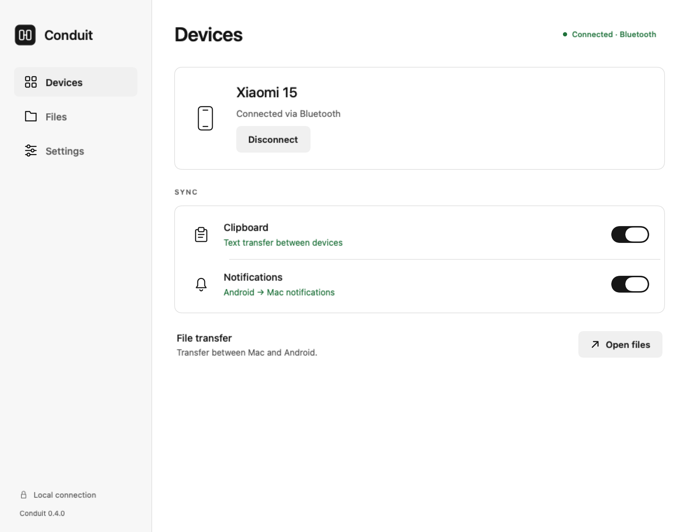
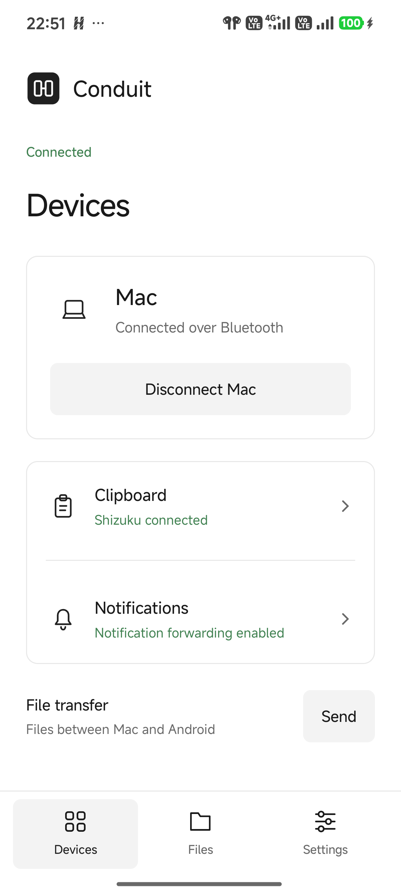

# Conduit

**English** · [Русский](README.ru.md)

Clipboard, notifications and files between Android and Mac over Bluetooth. No account or cloud service.

**[Download the latest release](https://github.com/ogolknev/conduit/releases/latest)** · [Build from source](docs/BUILDING.md)

## Screenshots

<table>
  <tr><th>macOS</th><th>Android</th></tr>
  <tr>
    <td width="74%" valign="top">
      <picture>
        <source media="(prefers-color-scheme: dark)" srcset="docs/images/mac-en-dark.png">
        
      </picture>
    </td>
    <td width="26%" valign="top">
      <picture>
        <source media="(prefers-color-scheme: dark)" srcset="docs/images/android-en-dark.png">
        
      </picture>
    </td>
  </tr>
</table>

macOS: UI preview with a simulated connection. Android: capture from a Xiaomi 15. Images follow your GitHub theme.

## Features

| Feature | Support |
| --- | --- |
| Clipboard | Automatic Mac → Android; Android → Mac manually or automatically with Shizuku |
| Notifications | Mac inbox with local history; dismiss on phone or reply when supported |
| Files | Transfer both ways, up to 100 MB per file over Bluetooth |
| Connections | Bluetooth, or USB / Wi-Fi through ADB |
| Interface | English and Russian; light and dark themes |

## Install

| Device | Requirements | Download |
| --- | --- | --- |
| Mac | Apple Silicon, macOS 13+ | macOS ZIP from the release |
| Phone | Android 8+ | Companion APK from the same release |

Unzip the Mac app into **Applications** and install the APK on your phone. The APK is also bundled with the Mac app.

The downloadable Mac build is not notarized. If macOS blocks it, see [Apple's opening instructions](https://support.apple.com/en-us/102445).

## Connect

1. Open Conduit on both devices. Pair the phone and Mac in **system Bluetooth settings**.
2. On Android, select **Enable connection** and allow nearby device access.
3. Select **Add Mac** on Android to get an eight-digit Conduit code.
4. On Mac, select **Connect phone → Bluetooth**, choose the phone and enter that code.
5. For notifications, enable **Settings → Notification access** on Android and allow Conduit notifications on Mac.

The Conduit code is separate from the system Bluetooth pairing code. Later connections use the saved authorization. Conduit reconnects automatically while the Mac app is running; opening Bluetooth settings again is not required.

On Mac, enable **Settings → Launch at login**. On Xiaomi, enable **Settings → Xiaomi autostart** for Conduit once. This is separate from battery optimization and allows the Android service to return after updates and restarts.

Language follows the system by default. Change it in **Settings → Language** on either device.

## Automatic clipboard from Android

Install and start [Shizuku](https://shizuku.rikka.app/download/), then enable **Settings → Automatic sending** in Conduit and grant its request.

On Android 11+, Shizuku can start through wireless debugging without a USB cable. Follow its [setup guide](https://shizuku.rikka.app/guide/setup/). Start it again after restarting an unrooted phone.

Without Shizuku, use **Settings → Send clipboard** on the phone.

## Notes

- This is a prototype, tested on Xiaomi 15 / Android 16 and Apple Silicon / macOS 26.6.2. See [validation notes](docs/VALIDATION.md) for the tested scope.
- Clipboard sync supports text only and keeps no history. Android-to-Mac reading may pause while the phone is locked.
- Bluetooth is slower than Wi-Fi. Received files go to `~/Downloads/Conduit` on Mac and `Download/Conduit` on Android 10+.
- Launch at login on Mac and background autostart on Android restore an enabled connection after a restart. Reports are available in **Settings → Diagnostics**; clipboard and notification content is excluded.

## Development

[Build, design and validation](docs/README.md) · [Release history](https://github.com/ogolknev/conduit/releases)

## License

[MIT](LICENSE). You may use, modify and redistribute Conduit, including commercially, while preserving the copyright and license notice. Third-party components retain their [own licenses](THIRD_PARTY_NOTICES.md).
