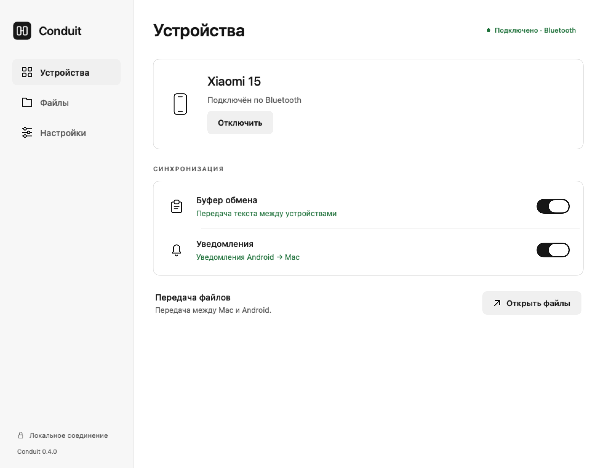
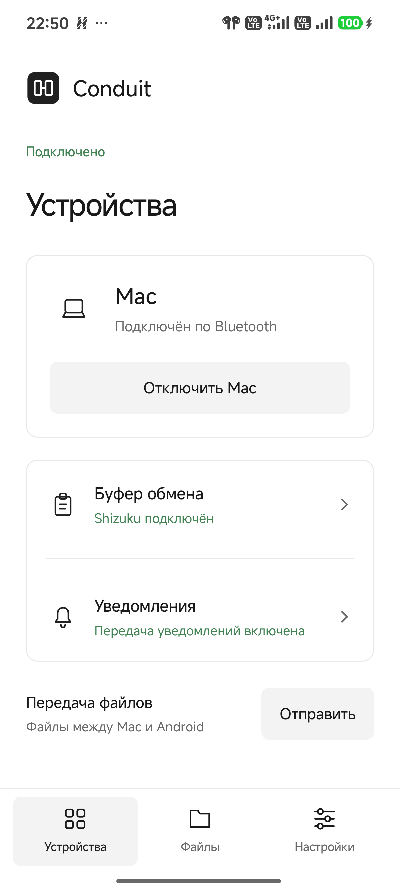

# Conduit

[English](README.md) · **Русский**

Буфер обмена, уведомления и файлы между Android и Mac по Bluetooth. Без аккаунта и облачного сервиса.

**[Скачать последний релиз](https://github.com/ogolknev/conduit/releases/latest)** · [Сборка из исходников](docs/BUILDING.md)

## Скриншоты

<table>
  <tr><th>macOS</th><th>Android</th></tr>
  <tr>
    <td width="74%" valign="top">
      <picture>
        <source media="(prefers-color-scheme: dark)" srcset="docs/images/mac-ru-dark.png">
        
      </picture>
    </td>
    <td width="26%" valign="top">
      <picture>
        <source media="(prefers-color-scheme: dark)" srcset="docs/images/android-ru-dark.png">
        
      </picture>
    </td>
  </tr>
</table>

macOS: превью интерфейса с тестовым подключением. Android: снимок с Xiaomi 15. Изображения соответствуют теме GitHub.

## Возможности

| Функция | Поддержка |
| --- | --- |
| Буфер обмена | Автоматически с Mac на Android; обратно — вручную или автоматически через Shizuku |
| Уведомления | Передача выбранных приложений на Mac; закрытие и ответ, если исходное приложение его поддерживает |
| Файлы | В обе стороны, до 100 МБ на файл по Bluetooth |
| Соединение | Bluetooth или USB / Wi-Fi через ADB |
| Интерфейс | Русский и английский языки; светлая и тёмная темы |

## Установка

| Устройство | Требования | Что скачать |
| --- | --- | --- |
| Mac | Apple Silicon, macOS 13+ | ZIP для macOS из релиза |
| Телефон | Android 8+ | APK-компаньон из того же релиза |

Распакуй Mac-приложение в **Программы** и установи APK на телефон. APK также входит в Mac-сборку.

Mac-сборка подписана ad hoc, без нотарификации. Если macOS блокирует открытие, смотри [инструкцию Apple](https://support.apple.com/en-us/102445).

## Подключение

1. Открой Conduit на обоих устройствах. Выполни сопряжение телефона и Mac в **системных настройках Bluetooth**.
2. На Android нажми **Включить соединение** и разреши доступ к устройствам поблизости.
3. Нажми **Добавить Mac** на Android, чтобы получить восьмизначный код Conduit.
4. На Mac нажми **Подключить телефон → Bluetooth**, выбери телефон и введи этот код.
5. Для уведомлений включи **Настройки → Чтение уведомлений** на Android и разреши уведомления Conduit на Mac.

Код Conduit отличается от кода системного сопряжения Bluetooth. При следующих подключениях используется сохранённое разрешение.

По умолчанию язык соответствует системному. Изменить его можно в **Настройки → Язык** на любом устройстве.

## Автоматический буфер с Android

Установи и запусти [Shizuku](https://shizuku.rikka.app/download/), затем включи **Настройки → Автоматическая отправка** в Conduit и разреши запрос.

На Android 11+ Shizuku запускается через беспроводную отладку без USB-кабеля. Следуй [официальной инструкции](https://shizuku.rikka.app/guide/setup/). На телефоне без root после перезагрузки его нужно запускать снова.

Без Shizuku используй **Настройки → Отправить буфер** на телефоне.

## Ограничения и диагностика

- Это прототип, проверенный на Xiaomi 15 / Android 16 и Apple Silicon / macOS 26.6.2. Объём проверок — в [VALIDATION.md](VALIDATION.md).
- Буфер поддерживает только текст и не хранит историю. Чтение с Android может приостанавливаться при блокировке телефона.
- Bluetooth медленнее Wi-Fi. Входящие файлы сохраняются в `~/Downloads/Conduit` на Mac и `Download/Conduit` на Android 10+.
- После перезагрузки открой оба приложения. Отчёты доступны в **Настройки → Диагностика**; содержимое буфера и уведомлений в них не входит.

## Разработка

[Сборка из исходников, EN](docs/BUILDING.md) · [Интерфейс и иконки, EN](design/README.md) · [История релизов](https://github.com/ogolknev/conduit/releases) · [Сторонние компоненты, EN](THIRD_PARTY_NOTICES.md)
